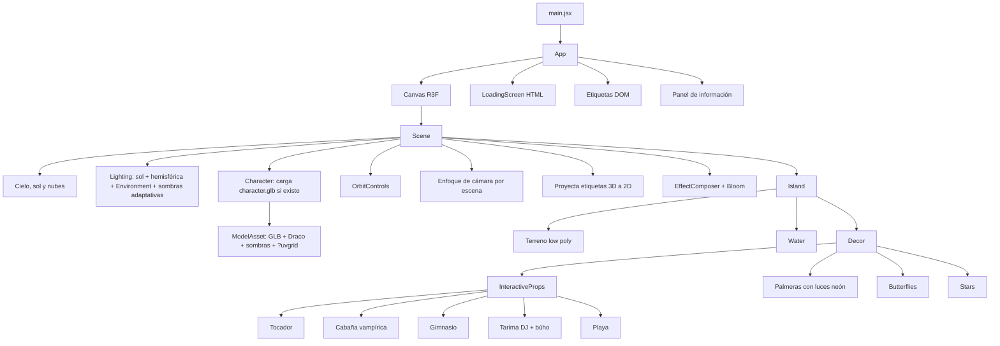
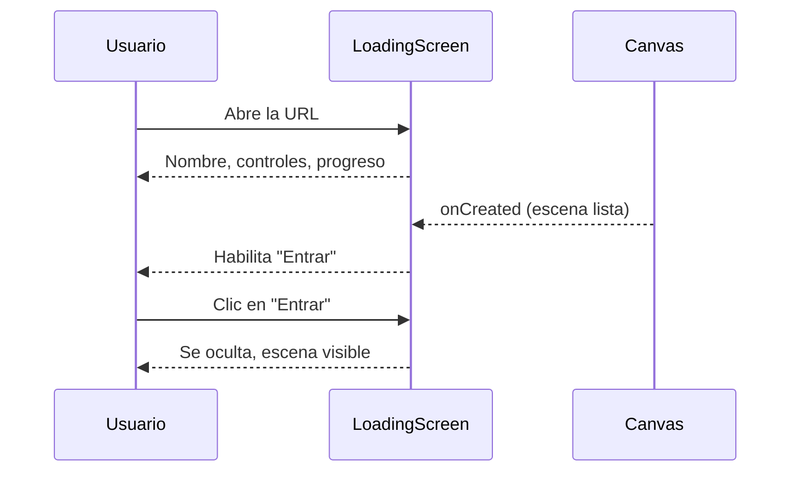

# Arquitectura técnica

## Stack
- **Vite 6** (bundler) + **React 19**
- **Three.js** vía **React Three Fiber** y **@react-three/drei**
- Despliegue: GitHub Pages con GitHub Actions
- Efectos: `@react-three/postprocessing` (Bloom)
- Planeado: Zustand (estado, Sprint 3), cannon-es/Rapier (físicas, Sprint 3)
- Sprint 2: pipeline Blender → GLB con Draco ([pipeline-blender.md](pipeline-blender.md)), materiales PBR/matcap, iluminación y sombras adaptativas

## Árbol de componentes (Sprint 1)

## Flujo de carga

## Decisiones
| Decisión | Motivo |
|---|---|
| Vite + R3F | Arranque rápido, componentes declarativos |
| `base: './'` en Vite | Rutas relativas válidas en cualquier hosting |
| Terreno procedural low poly, estilo playa (Sprint 1) | Isla provisional hasta tener el modelo de Blender (Sprint 2) |
| Etiquetas DOM proyectadas (no drei `Html`) | `Html` lanza errores de React 19 al desmontar su root |
| Contenido en `src/data/content.js` | Editar la información sin tocar componentes 3D |
| Sol bajo con sombras largas + `layout.js` | Terreno se aplana alrededor de cada escena; posiciones centralizadas |
| Neón con `emissive` + `toneMapped={false}` + Bloom | Brillo sin texturas ni luces extra |
| Shadow map `percentage` | `soft` (PCFSoft) fue removido de Three r18x |
| `materials.jsx` (Wood, Glass, Metal, Matcap) con texturas procedurales | PBR/matcap sin descargas; `Glass` usa clearcoat en vez de transmisión (barato en móvil) |
| `Lighting.jsx` usa `SUN_DIR` de `Sky.jsx` | El sol visible y la luz que proyecta sombras nunca se desalinean |
| Shadow map 1024 en táctil/pantalla pequeña, 2048 en escritorio | Rendimiento en móvil |
| `ModelAsset` con `import.meta.glob` | Si falta el `.glb` no se rompe el build; Draco local en `public/draco` |
| Se retiró la muñeca jugable, el joystick y `useInput` | Decisión de la autora; el movimiento del personaje se retoma en Sprint 3 con físicas |